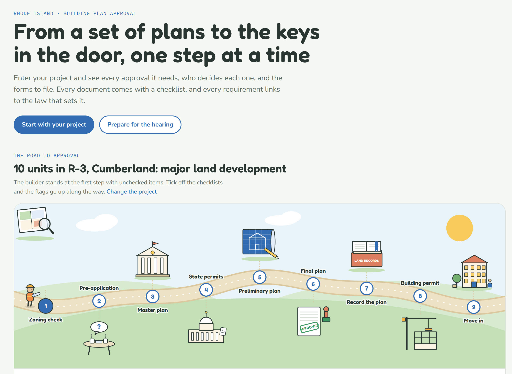

# RI Building Plan Approval

[](https://maqz-bromberg.github.io/ri-development-approval/)

**Live site: [maqz-bromberg.github.io/ri-development-approval](https://maqz-bromberg.github.io/ri-development-approval/)**

A Next.js site that turns a building project anywhere in Rhode Island into its approval route. It shows every step, who decides it, the documents to file with a checklist for each, the law quoted word for word for each requirement, the boards and their meetings, past projects like yours with their decisions, and notes for answering common objections at the hearing.

No town has confirmed the reading yet. Everything the site says comes with its source, and what has not been read is shown as a gap, not hidden.

## Coverage

Every one of the 39 cities and towns gets the state-law route, its boards from the state Open Meetings site, and its zoning districts from the Rhode Island Zoning Atlas (HousingWorks RI). Beyond that, each town's coverage is four marks (zoning, boards and offices, local steps, hearings and precedent), each read, partly read or not read, and its level follows from them. The Towns page shows them all on a map.

| | Towns |
| --- | --- |
| Own zoning read in place of the Atlas | 20: Cumberland and Providence; Charlestown, Westerly and North Providence; Foster, Exeter, Hopkinton, Richmond, Glocester and West Greenwich; Pawtucket, Cranston, East Providence, Woonsocket, Warwick, Newport, Central Falls and Smithfield; New Shoreham |
| Own review steps | Cumberland and Providence in full; four small towns for the comprehensive permit; the seven cities' practice from their minutes |
| Past projects from the boards' records | 74 projects followed to a decision from the minutes, in 14 towns: Providence's and Cumberland's cases read one by one, and 12 more towns' agendas searched for housing (two more were searched and found no multi-family proposals) |

How the coverage was built, town by town, is in `docs/plans/statewide-coverage.md`. What is still open is in `docs/review-after-chunk-7.md`, and what is waiting to be saved by hand is in `docs/manual-fetches.md`.

## Run it

```bash
npm install
npm run dev        # http://localhost:3000
npm run build && npm start
npm run typecheck
```

## Check it

The data is checked against the documents it quotes, which are kept in `.sources/` (not committed). After a change, run them all with `npm run check` (`-- --fast` leaves out the type check); it says which passed and shows the output of any that failed, and skips, by name, a check whose local files are missing. One by one, with `scripts/towns/README.md` for more:

```bash
python3 scripts/towns/verify_quotes.py      # every quote, word for word, against its document
python3 scripts/timelines/verify.py .sources # every dated event in the precedent timelines
python3 scripts/check_engine_flows.py        # the engine flowcharts' pointers into the code
node --import ./scripts/engine/register.mjs scripts/engine/snapshot.ts   # the engine against its committed digest and the local copy; --save after a change that was meant, and commit the digest
npm test                                     # known answers: the engine's rules and the share link, each citing the law or decision it encodes
```

## Pages

| Route | What it does |
|---|---|
| `/` | **Landing**, leading to choosing a site: a find box, open a project file, recent and saved sites, the example. Every page after it is an app shell: a header with five stages, a Reference menu and a save chip; a rail with the site card and an outline; a tray with pins, the hearing sheet and the route's contacts. |
| `/site` | **Site**: where (an address, a parcel or the map), the district and any overlays, the project and the land, then nearby alternatives and the five routes. |
| `/law` | **Zoning & law.** The verdict and every finding, each with its rule and quote, including what the town's own ordinance says where it was read and the gaps where it was not. |
| `/route` | **Route & people.** One row per step: what you file, who decides, the clock. Rows open to documents, questions to expect and contacts. Past projects at the end. |
| `/calendar` | **Calendar.** A Gantt chart and a month view from your start date, with board meeting dates where a published calendar was read, and a note when a hearing falls in a month the board rarely meets. |
| `/hearing` | **Hearing**: the hearing body, date and notice, and questions matched to what was actually raised at the town's own hearings. |
| `/towns` | **Towns**: every municipality's coverage on a map, shaded by level or by mark, with its code of ordinances. |
| `/records` | Where each town's boards publish their records, what was searched for housing and found, and the past projects. |
| `/docs`, `/docs/sources` | How site facts are found, and every cited source by town and kind, with a note where the copy read may not be the official one. |
| `/engine` | How the engine works, as flowcharts pointing into the code. |
| `/verification`, `/after-approval` | How a record gets onto a timeline; what happened after approval. |
| `/summary`, `/glossary`, `/atlas` | The whole project on one printable page; plain-language terms (underlined across the site); Cumberland's districts from the Atlas. |

Project inputs, ticks and notes are saved in the browser (`localStorage`). To keep a project, use a share link (the project is encoded in the link's `#p=` fragment, and nothing is sent to a server), a downloaded project file, or the printable summary.

Under `npm run dev`, `/dev` lists the open questions, design trials and debts.

## Where the data lives

How the data is shaped, and each decision behind it, is in **`docs/ARD.md`** (the architectural review document). Read it before changing the shape of the data, the engine, the sources or the checks, and update it in the same change.

- `lib/data/state/trees.ts`: the state-law routes (`byright`, `dpr`, `minor`, `major`, `comp`), each step with its application, clock, deciders and documents. Each requirement has `src`, `pin` and a verbatim `q`.
- `lib/data/towns/<town>/`: what a town lays over state law, as far as it has been read: its use table and other rules, with everything the engine asks of the town exported as `RULES` from its `rules.ts`; its steps, its recorded projects (`history.ts` with `timelines.json`), and its contacts. Each town's `RULES` is listed by name in `lib/data/towns/overlay.ts`. Shared helpers: `useTable.ts` (a use table's row as a finding), `dated.ts` (rules with dates), `compPermit.ts` (a town's comprehensive permit route), `cityRoutes.ts` (the cities' practice from their minutes).
- `lib/data/towns.ts`: every municipality's four marks, gaps, and link to its code of ordinances.
- `lib/data/sources.ts`: every document quoted, by id. The scripts read it through `scripts/data.ts` (Node 24).
- `lib/data/bodies.json`: every town's boards from the state Open Meetings site, with their meeting pattern and quiet months.
- `lib/data/searched.ts` and `towns/records-searched.json`: what each town's board records were searched for, and the housing found.
- `lib/data/history.ts`: all recorded projects, joined from the towns' folders.
- `lib/data/objections.ts`, `towns/rural-hearings.ts`: the hearing questions, each with the concerns actually raised, cited to the minutes.

`lib/engine.ts` holds the rules that apply everywhere: classification, use and density, parking, the site flags and the findings, with each town's own answers taking the Atlas's place where they were read. `lib/schedule.ts` lays the steps on dates, `lib/lookup.ts` turns an address into site facts from live state map services, and `lib/share.ts` encodes a project into a link or file.

## Adding a town

1. Save its zoning ordinance (most hosts refuse scripts; `docs/manual-fetches.md` says how) and add its sources to `lib/data/sources.ts`.
2. Give it a folder, `lib/data/towns/<town>/`, with what was read, export its `RULES` from the folder's `rules.ts`, and add that to the list in `lib/data/towns/overlay.ts`. A use table usually comes first: `useTable.ts` turns its rows into findings.
3. Search its boards' records with `python3 scripts/towns/search_records.py "<Town>"`, read what was found into `lib/data/searched.ts`, and follow the projects to a decision in `history.ts` and `timelines.json`.
4. Set its marks in `lib/data/towns.ts`, run the checks, and add a decision and a log line to `docs/ARD.md`.

## Not yet built

- Each town's own clocks, fees and checklists beyond Cumberland and Providence. Five cities' regulations are in hand to read next.
- Text recognition for scanned minutes and agendas, and transcription of meeting videos.
- Flood zone lookup, and bus frequency for the transit flag.
- Commercial use tables, parking and dimensions outside Providence, Cumberland, Charlestown and Westerly.
- Business days: schedules count calendar days, as the statutes do, and meeting dates are estimated where no board calendar was read.
- Plan-set extraction: uploaded files are only listed.

Plans for the larger pieces are in `docs/plans/`.
