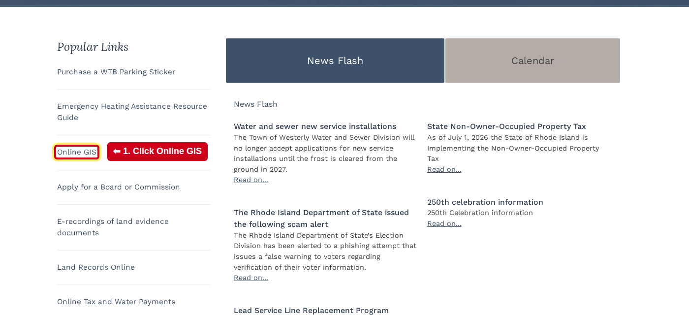
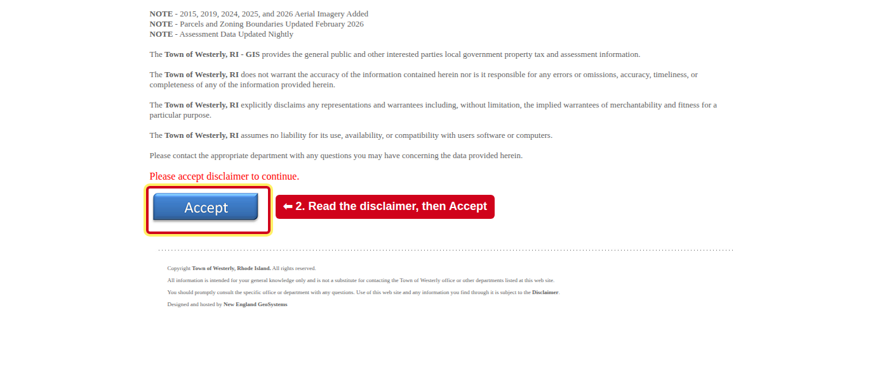

# Documents to save by hand: a step-by-step guide

Kept with `docs/plans/statewide-coverage.md` (ARD D53). Checked on 2026-11-18. Everything below either refuses a script, or needs a person to accept something on the page. What a script can now reach has been fetched and is listed at the end, so it needs nothing from you.

## How to save, and how to check it worked

1. Save each file anywhere inside `.sources/` in the repository. The name the browser gives it is fine.
   - A **PDF**: open it and save it, or right-click the link and choose *Save link as*.
   - A **web page**: *File → Save Page As*, and choose **Webpage, HTML only** (not "complete"; that adds a folder of images).
2. Run `python3 scripts/towns/organize_sources.py`.
3. It prints how many sources are in hand, then lists anything it could not file under **Unrecognised, left in place**. A file there arrived but is not yet a cited source; that is fine for a staff report not yet read, and I register it when I read it. A source still `missing` in `.sources/INDEX.md` did not arrive.

A saved web page is now recognised by the address the browser writes inside it, so its file name no longer matters. That was why the Providence pages below could not be filed before, even if they had been saved.

A whole ordinance can be saved straight into `.sources/` too: a PDF, Word file or web page whose file name names the town and says zoning, ordinance or code ("Bristol, RI Code of Ordinances.pdf", "FOSTER_ZONING.docx") is moved to `<town>/ordinance/` and turned to text. A file the organizer cannot place stays where it is and is listed under **In hand, not yet cited** in `.sources/INDEX.md`; a file that is not a cited source yet is filed by hand under its town and listed there too.

## What happened with the first Providence fetch

`.sources/INDEX.md` after running the organizer on 2026-11-18:

- **Arrived:** every PDF the sources list asked for. Four more PDFs arrived that are not yet sources, and are kept for reading: the February 2023 preliminary plan staff report for 116 Waterman Street (case 22-033MA, which is on the list below), a November 2023 memo to the Commission on regulation changes, and the staff reports for referrals 3562 (748 Atwell Avenue) and 3564 (355 Thurbers Avenue).
- **Missing:** the six City web pages in section 1a. Each still says `missing`.

## What happened with the second fetch (2026-11-18, evening)

- **Providence staff reports: read.** Every report saved was found at its address on providenceri.gov by web search and registered (`psr…`); three whose address was not found are registered against the year's meeting materials page, with `file: ".pdf"`. With the minutes from the state site (14 more, 9 of them scans read by eye), all 20 Commission cases since 2023 that give a number of homes (19 projects; 203 Douglas Avenue is still pending) are now read into the precedent. Providence's hearings mark is now citywide (partly: commercial cases and the other boards are not read).
- **Historic District Commission and Zoning Board: read.** The certificate of appropriateness step has its clock (45 days from acceptance, or deemed approved), filing deadlines, conceptual approval and expiry; both boards' contact cards have their meetings and filing.
- **Ordinances:** 22 towns' copies arrived (listed in section 3). They are filed for reading, not yet read.
- **Not used yet, filed and listed in `.sources/INDEX.md`:** the Building Board of Review schedule and instructions, the notice of appeal form, the local historic district map package, the state preservation office's annual report, the November 2023 memo on the regulations, four City Council referrals (748 Atwells, 355 Thurbers, 21 and 25 Douglas, the student housing amendment), the design waiver at 1101 Elmwood; for Westerly, the zoning map, the map amendment application, Planning Board minutes of February 21, 2023, the Westerly Crossings expansion package (2017, a scan) and the wastewater plan excerpts; New Shoreham's plan review form.

## 1. Providence

No screenshots here: providenceri.gov sits behind a firewall that refuses automated requests, and a headless browser was refused too, so I did not try to get round it. The steps below are exact instead.

### 1a. Six City pages: in hand

**Done 2026-11-18:** all six arrived and were filed by the address inside each saved page. Kept here for the record.

Open each address in your browser and save it as *Webpage, HTML only*. Each fills a contact card or a step that now says "not read".

| Source | Open this page | What it fills |
| --- | --- | --- |
| `pcpc` | <https://www.providenceri.gov/planning/cpc/> | The City Plan Commission card: agendas, forms, staff contacts |
| `pabout` | <https://www.providenceri.gov/planning/about-the-cpc/> | The Commission's membership and appointment |
| `padmin` | <https://www.providenceri.gov/planning/department-of-planning-and-development-administrative-project-reviews/> | Projects decided by staff with no hearing (135 Gano Street and others) |
| `pddrc` | <https://www.providenceri.gov/planning/downtown-design-review-committee-ddrc/> | The downtown design review step: its schedule and application, now "not read" |
| `pstaff` | <https://www.providenceri.gov/planning/3626/> | The planning staff directory |
| `pis` | <https://www.providenceri.gov/inspection-standards/> | The Department of Inspection and Standards card |

If a page will not open, or opens on a firewall notice, say which. That is a finding in itself.

### 1b. Staff reports for the housing cases not yet read

These are the City Plan Commission cases since 2023 that give a number of homes and are not yet read into the site's precedent (the Records card marks them **Gap**). The staff report is the best single document per hearing.

**Where:** the meeting materials archive lists one page per year: <https://www.providenceri.gov/planning/cpc-meeting-materials-archive/>. Open the year, find the meeting date in the second column below, and look for the link that names the case number or the address with "staff report". Save the PDF.

| Case | Address | Homes | Area | Year page | Meetings to look under |
| --- | --- | --- | --- | --- | --- |
| 22-033MA | 116 Waterman Street | 25 | College Hill | [2023](https://www.providenceri.gov/planning/2023-cpc-meeting-materials/), [2025](https://www.providenceri.gov/planning/2025-cpc-meeting-materials/) | **In hand:** the preliminary plan report and the February 2023 report. Still wanted: Aug 19, 2025 |
| 22-069MA | 541 Hartford Avenue | 30 | Hartford | [2023](https://www.providenceri.gov/planning/2023-cpc-meeting-materials/) | Jan 24, 2023 |
| 23-030MA | 108–110 Waterman Street | 26 | College Hill | [2023](https://www.providenceri.gov/planning/2023-cpc-meeting-materials/) | **In hand:** the master plan reports (the files say case 22-030MA) |
| 23-064MI | 106 Reservoir Avenue | 21 | Reservoir | [2024](https://www.providenceri.gov/planning/2024-cpc-meeting-materials/) | Feb 20, 2024 |
| 24-049MA | 279 Thayer Street | 16 | College Hill | [2024](https://www.providenceri.gov/planning/2024-cpc-meeting-materials/) | Sep 17, 2024 |
| 24-050MA | 400 Elmwood Avenue | 24 | Elmwood | [2024](https://www.providenceri.gov/planning/2024-cpc-meeting-materials/) | Sep 17 and Oct 15, 2024 |
| 24-051MI | 11 W Friendship Street | 26 | Elmwood | [2024](https://www.providenceri.gov/planning/2024-cpc-meeting-materials/) | Sep 17, 2024 |
| 24-060MI | 551 Chalkstone Avenue | 23 | Smith Hill | [2024](https://www.providenceri.gov/planning/2024-cpc-meeting-materials/) | Nov 19, 2024 |
| 24-062MI | 663 Admiral Street | 48 | Wanskuck | [2024](https://www.providenceri.gov/planning/2024-cpc-meeting-materials/) | Nov 19, 2024 |
| 25-002MI | 217 Angell Street | 32 | College Hill | [2025](https://www.providenceri.gov/planning/2025-cpc-meeting-materials/) | Mar 18, 2025 |
| 25-013MI | 327 Elmwood Avenue | 44 | West End | [2025](https://www.providenceri.gov/planning/2025-cpc-meeting-materials/) | Apr 15, 2025 |
| 25-019MI | 1107 Westminster Street | 17 | Federal Hill | [2025](https://www.providenceri.gov/planning/2025-cpc-meeting-materials/) | May 20, 2025 |
| 25-044UDR | 290 and 298 Public Street | 39 | Lower South Providence | [2025](https://www.providenceri.gov/planning/2025-cpc-meeting-materials/) | Aug 19 and Sep 16, 2025 |
| 24-053MIL | 885 Westminster Street | 74 | Federal Hill | [2025](https://www.providenceri.gov/planning/2025-cpc-meeting-materials/) | Sep 16, 2025 |
| 26-047MIL | 203 Douglas Avenue | 21 | Smith Hill | [2026](https://www.providenceri.gov/planning/2026-cpc-meeting-materials/) | Jul 28 and Aug 18, 2026 |
| 26-070MAL | 31 Dike Street | 28 | Olneyville | [2026](https://www.providenceri.gov/planning/2026-cpc-meeting-materials/) | Sep 15, 2026 |

Already read, nothing to fetch: 269 Wickenden Street, 27 East River Street, 128 Wayland Avenue, 150 Pitman Street, 135 Gano Street. The minutes for every case come from the state Open Meetings site by script; 3 of the 55 agendas since 2023 are scans.

**Done 2026-11-18:** all read. The last two, below, arrived later the same evening; their addresses were found by web search:

| Wanted | Address | Why |
| --- | --- | --- |
| 327 Elmwood Avenue, staff report (25-013MI) | <https://www.providenceri.gov/wp-content/uploads/2025/04/25-013MI-327-Elmwood-Ave-preliminary-plan-staff-report.pdf> | The project is read from the minutes alone |
| 108–110 Waterman Street, preliminary plan staff report | <https://providenceri.gov/wp-content/uploads/2024/07/22-030MA-108-110-Waterman-Street-preliminary-plan-staff-report.pdf> | The master plan is read; the preliminary plan's outcome is not (that month's agenda is a scan) |

203 Douglas Avenue (26-047MIL) has no staff report posted yet: it was continued to October 20, 2026.

### 1c. Pages for the review areas

**Done 2026-11-18** for the Historic District Commission's rules, 2024 amendment to its standards, application package and 2026 schedule, and the Zoning Board's policies and 2026 schedule. Still not read: the Commission's design standards for each district.

Search providenceri.gov for each, and save the page and any linked PDF of standards or schedules.

- **Historic District Commission**: its standards and guidelines, and its meeting and filing schedule. These answer the "not read" on the certificate of appropriateness step.
- **Zoning Board of Review**: its meeting schedule (its meetings are on the state site; its own page is not).

## 2. Westerly

Westerly's town site and its GIS show in a browser, so these have screenshots. The GIS asks you to accept a disclaimer, which is yours to accept, not a script's.

**1. On <https://www.westerlyri.gov/>, scroll to *Popular Links* and click *Online GIS*.**

**2. Read the GIS disclaimer, then click *Accept*.** The page notes that parcels and zoning boundaries were updated in February 2026.

**3. The layer list: done.** Maqz saved the GIS legend on 2026-11-18 (source `wegis`). What it shows, now in the site:
- **On the Town's GIS:** the Bed-and-Breakfast, Granite Street, Historic Mill and Wells Street overlays; the Airport 1 and 2 Overlay Areas and the airport hazard zones A to E; four historic districts (Wilcox Park, Bradford, Watch Hill, Westerly Downtown), which the ordinance does not treat as zoning overlays (its Historic Overlay is reserved); seven fire districts.
- **Not on it:** the Aquifer Protection and Wellhead Protection zones, and the Salt Pond Overlay. Each overlay's tick on Site now says which.
- **An R-6 district** on the zoning layer that the ordinance does not have. Its only R-6 is a 1998 map amendment ("From M-1 to R-6"), so it is probably an old label.

The GIS is a viewer behind a disclaimer, not a service the lookup can ask, so the overlays stay ticks (debt 29). **To ask the Planning office**, when someone does: whether the zoning and overlay layers are published as a map service; where the aquifer, wellhead and Salt Pond maps are; and what R-6 is.

**4. The Official Zoning Map as a PDF**, if one is posted: search the town site for "zoning map" (<https://www.westerlyri.gov/Search?searchPhrase=zoning%20map>), and save the PDF. The ordinance adopts the "Official Zoning Map, Town of Westerly, Rhode Island, July 1, 2019", as amended (§ 260-16).

**5. The Airport Area Overlay's confliction area maps 2A to 2D** (the GIS shows the overlay areas and hazard zones, not the confliction areas), and the Aquifer, Wellhead and Salt Pond maps, if the Planning or Zoning office posts them.

## 3. Ordinances for chunks 5 to 7 and later

**Arrived by 2026-11-18, evening**, filed in `.sources/<town>/ordinance/`: Bristol, Burrillville, Central Falls, East Providence (Municode PDFs); Exeter, Foster, Hopkinton, Jamestown, Narragansett, Newport, North Kingstown, South Kingstown, Tiverton, Warwick, West Warwick (Municode Word files); Middletown (American Legal); Smithfield (its own zoning ordinance, a 200-page PDF amended to 2026, from the town's site); North Smithfield (the eCode360 chapter and the whole eCode360 code, still not the official copy); North Providence (the 2026 redline and the amended ordinance); New Shoreham (four articles and the districts page from Zoneomics, a third party's copy; nine zoning appendix attachments of 1994 onward; Ordinance 2024-14 on short-term rentals); Warwick also as the whole Municode code (its Appendix A is the zoning).

**Two Word files are only links:** Providence's Municode chapter 27 points to the City's own ordinance (in hand as `pzo`), and Warren's chapter 32 says its zoning ordinance is a separate Municode publication: <https://library.municode.com/ri/warren/codes/zoning_ordinance>. Save that one instead. Warren's code link on the site now points there.

**Arrived later the same evening:** Cranston (Municode PDF) and Warren's zoning publication (Word), and the two Providence staff reports still wanted (327 Elmwood and the 108–110 Waterman preliminary plan, both now read).

**New Shoreham, for chunk 5:** Appendix E, the zoning ordinance, as a PDF (186 pages, from eCode360's layout), saved 2026-11-18 into `.sources/new-shoreham/ordinance/`. The Town's own website links to its eCode360 copy (<https://ecode360.com/36749402>), though the Secretary of State lists its code as on ClerksHQ, where there is none: which copy is official is chunk 5's question, and the town's own link is evidence for eCode360.

**Not in hand:** Scituate: its Municode copy would not download for Maqz (2026-11-18). Its eCode360 copy, which is not the official one, is in `.sources/scituate/ordinance/`. New Shoreham's official copy is not in hand either.

**No screenshots for Municode or American Legal**: both refuse automated access, so I did not open them. The steps are the same for every Municode town.

**On Municode** (Foster, Exeter, Hopkinton, Cranston, East Providence, Newport, Central Falls, then Bristol, Burrillville, Jamestown, Narragansett, North Kingstown, Scituate, South Kingstown, Tiverton, Warren, West Warwick):

1. Open `https://library.municode.com/ri/<town>/codes/code_of_ordinances`, with the town as written in `lib/data/towns.ts` (for example `foster`, `east_providence`, `north_kingstown`).
2. In the table of contents on the left, find the zoning chapter. It is often an appendix ("Appendix A – Zoning") or near the end.
3. Open it, then use the **download** (or **print**) button above the text and choose the whole chapter, as a PDF.
4. Save it into `.sources/<town>/ordinance/`, and the subdivision and land development regulations too if they are a separate chapter.

**On American Legal** (Middletown): <https://codelibrary.amlegal.com/codes/middletown/latest/overview>; open the zoning title, then its print or download view, and save the PDF.

**Town websites:**
- **Warwick**: <https://www.warwickri.gov/city-council-legislative-department/pages/code-ordinances>. The city posts its zoning ordinance (Appendix A) and its amendments as separate PDFs; save the base and every amendment, with their dates. The text in force is the base plus each amendment in order.
- **North Smithfield**: its *Town Charter & Ordinances* page (<https://www.nsmithfieldri.org/284/Town-Charter-Ordinances>) lists document folders and no zoning chapter that I could see; the eCode360 copy in hand is not the official one. Ask the Town Clerk where the official zoning ordinance is published, or save it if you find it.
- **Smithfield**: done 2026-11-18. Its zoning ordinance (adopted 1998, amended to 2026) is a PDF on the town's site, <https://www.smithfieldri.gov/home/showpublisheddocument/5628/639283461558730000>, which refuses a script; the site's code link now points there.
- **New Shoreham**: the Secretary of State lists its code on ClerksHQ, but its ClerksHQ page holds board records and no town code. Look on <https://www.newshorehamri.gov/>, or ask the Town Clerk.

## Fetched by script on 2026-11-18: nothing to do

- **North Providence** (chunk 4): the zoning chapter (Chapter 35, saved by the town on May 11, 2026) and the subdivision chapter (31A), from ClerksHQ.
- **Richmond**: all of Title 18 (zoning), 27 chapters, from ClerksHQ. Richmond repealed its inclusionary zoning chapter (18.18) on May 21, 2024.
- **Woonsocket**: Appendix C, Zoning, from ClerksHQ.
- **Westerly**: the 2025 Route One Corridor Overlay binder (`wer1co`), and the Town Council's agendas and minutes since November 2025, which do not show the overlay adopted.

`scripts/towns/fetch_clerkshq.py` keeps the ClerksHQ addresses, so these can be fetched again.

## Not a fetch: questions for a person

These are not published, or not in a form the site can read. They stay named gaps until someone answers them.

- **Capital Center Commission (Providence).** Its last meeting on the state site was July 9, 2025, and the City's map layer for the Capital Center Special Development District is empty. Whether the Commission still reviews development downtown, and where its district lies, needs the City's planning office.
- **Westerly's inclusionary count.** The ordinance takes 15% of "the basic number dwelling units per acre permitted in the underlying zone"; the site takes 15% of the units entered. The planning office would say which.
- **Westerly's Route One Corridor Overlay.** Recommended to the Town Council in November 2025; not adopted as far as the council's filed agendas and minutes show. The Town Planner would know whether it is pending.
- **Whether 7 to 9 homes over shops are minor or major** in any town without its own line (state law § 45-23-32(19)(i)(C)). A reading the town makes.
